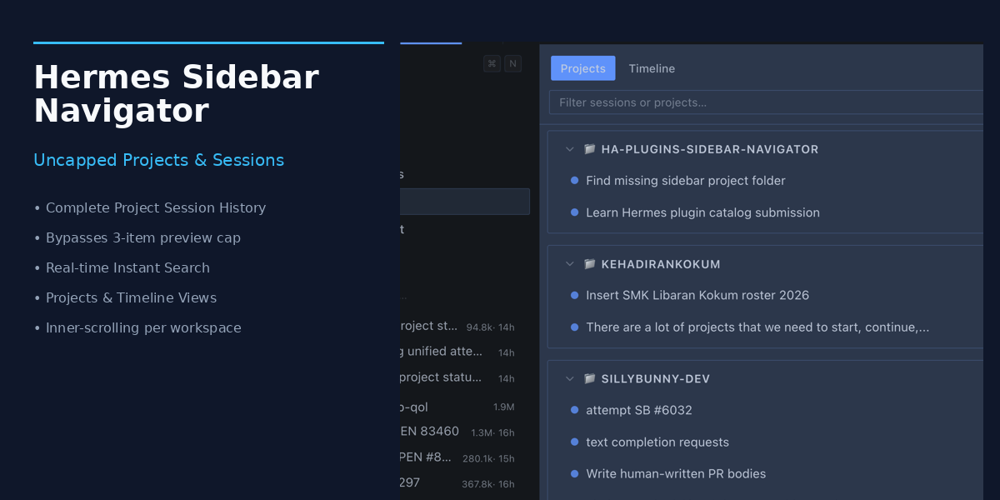
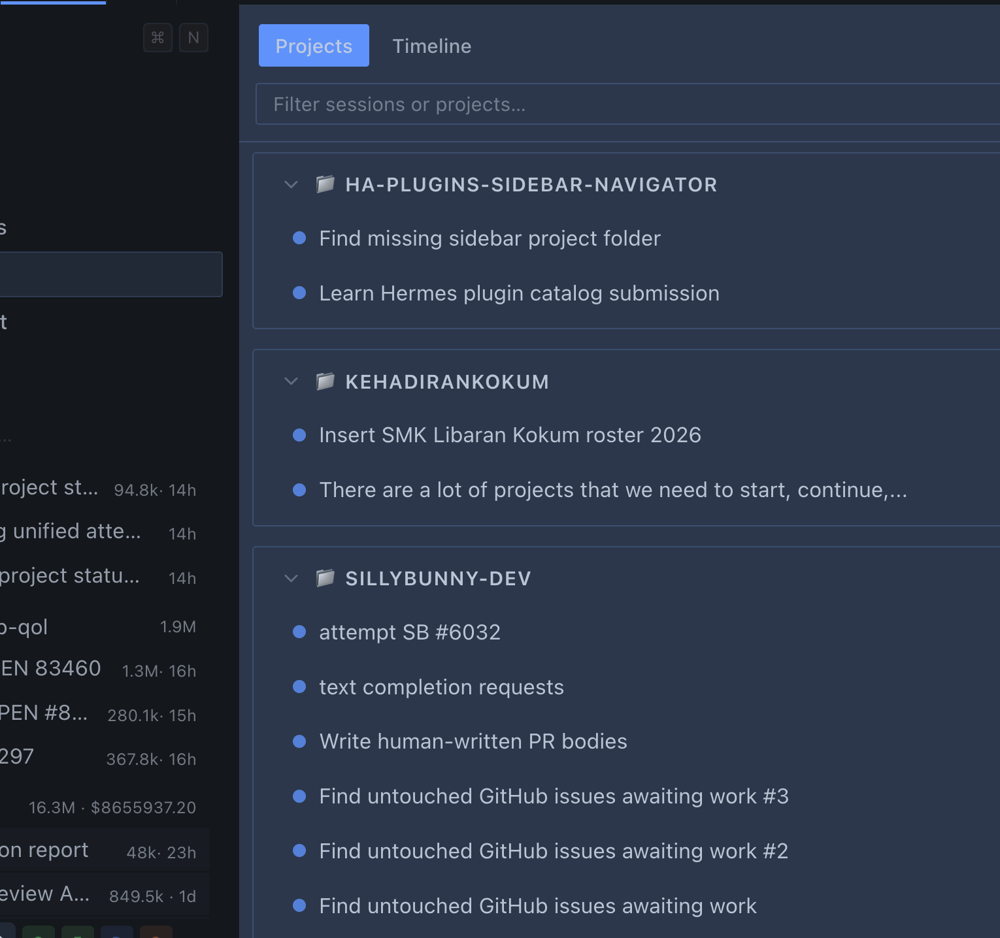

# HA-Plugins-sidebar-navigator



Full-power project and session navigator for **Hermes Desktop**. Bypasses the default 3-session sidebar overview limit and gives you smooth, scrollable, searchable access to all conversations.

---

## The Problem
In Hermes Desktop, the default sidebar project view limits previews to **3 sessions** per project (`PROJECT_PREVIEW_COUNT = 3`). As your project grows to dozens or hundreds of sessions, older sessions are hidden and impossible to browse or scroll without tedious search terms.

## The Solution: Sidebar Navigator
**Sidebar Navigator** is a lightweight, contribution-driven edge plugin that runs entirely on `@hermes/plugin-sdk` without modifying core files.

**Browse**
- **No 3-Session Cap:** Retrieves complete project trees and queries `projects.project_sessions` up to 2,000 sessions per project.
- **Inner-Scrolling Project Cards:** Each project shows its full session count and an inner-scrollable list.
- **Projects & Timeline Modes:** Grouped project trees, or a flat newest-first timeline of recent chats.
- **Profile Browsing:** A *Browse profile* selector lets you explore any profile's (and connection's) projects and sessions, not just the active one. Falls back to the active profile on older Hermes Desktop builds, and shows the real backend reason when a profile fails to load.
- **One-Click Jump:** Direct navigation to `#/<sessionId>` in the main conversation workspace.

**Find**
- **Instant Search:** Live filter across titles, preview snippets, and session IDs as you type.
- **Session Tags (v0.6):** Add up to 16 colour-coded tags per session (*Tags…* menu), then filter with the tag bar or `#tag` terms in the search box. Tags, colours and unread marks live in the plugin's own storage (`ctx.storage`), per profile route. Tags saved by older builds are imported automatically the first time you open a profile.

**See**
- **Live Status (v0.4):** Status dots on session rows show live state for the active profile (other profiles show a neutral dot).
- **Profile Identity Badges (v0.5):** A coloured profile glyph sits beside the status indicator so you can tell which profile a session belongs to.

**Act (right-click menus)**
- **Session menu:** New window, Rename, Pin, Mark unread, Appearance (colour), Copy ID, Tags, Branch, Export (JSON), Move to project, Archive, Delete.
  Pin and colour also update the real sidebar for the profile Desktop is currently showing (through `host.sessions`); for other profiles they are remembered by the Navigator only.
- **Where chooser (v0.7):** *New session (choose location)…* on sessions, project cards, and the Navigator background opens a dialog to start a session in Home or any project, with a project filter.
- **Project menu:** New session, Open Cockpit, Copy path.
- **Bulk actions (v0.8):** Click the checklist button in the header to enter select mode, tick sessions (or a whole project / the whole Timeline with the header checkbox), then **Tag…**, **Move…**, **Archive**, or **Delete** them in one go. Selection is scoped to one profile at a time. Sessions with a turn in flight are skipped, delete asks first, and anything that fails stays selected so you can retry.

---

## How It Works (Step-by-Step)

### 1. Launch Navigator
Click **Navigator** in the left sidebar menu (or press `Cmd/Ctrl + K` and search for *"Sidebar Navigator"*).



### 2. Browse by Project
Projects are listed with their folder badges, session counts, and expandable conversation lists. 

### 3. Filter, Tag, or Switch to Timeline
Use the search bar to filter across all projects simultaneously, click tags in the tag bar to narrow further, or toggle **Timeline** to see every conversation newest-first.

### 4. Act on Sessions
Select several at once with the checklist button for bulk tag, move, archive, or delete.

Right-click any session, project, or the empty Navigator background for the full action menu (rename, branch, export, move, archive, delete, new session in a chosen location).

---

## Installation

### Via Curated Hermes Plugin Catalog
```bash
hermes plugins install ha-sidebar-navigator
```

### Manual / Developer Mode
Copy `desktop-plugin/` (or symlink it) into your Hermes plugins directory:
```bash
mkdir -p ~/.hermes/plugins/ha-sidebar-navigator
cp -r desktop-plugin/* ~/.hermes/plugins/ha-sidebar-navigator/
```
Or install directly from GitHub:
```bash
hermes plugins install https://github.com/badiyee85/HA-Plugins-sidebar-navigator --subdir desktop-plugin
```
Press `Cmd/Ctrl + K` in Hermes Desktop and run **Reload desktop plugins**.

---

## Architecture & Compatibility
- **Runtime:** Native ESM loaded by Hermes Desktop via `@hermes/plugin-sdk`.
- **Styling:** Adheres strictly to Hermes host theme tokens (`var(--ui-text-*)`, `var(--ui-bg-*)`, `var(--chrome-action-hover)`).
- **Security:** Zero self-updating code; pure client-side view layer.
- **License:** MIT.
